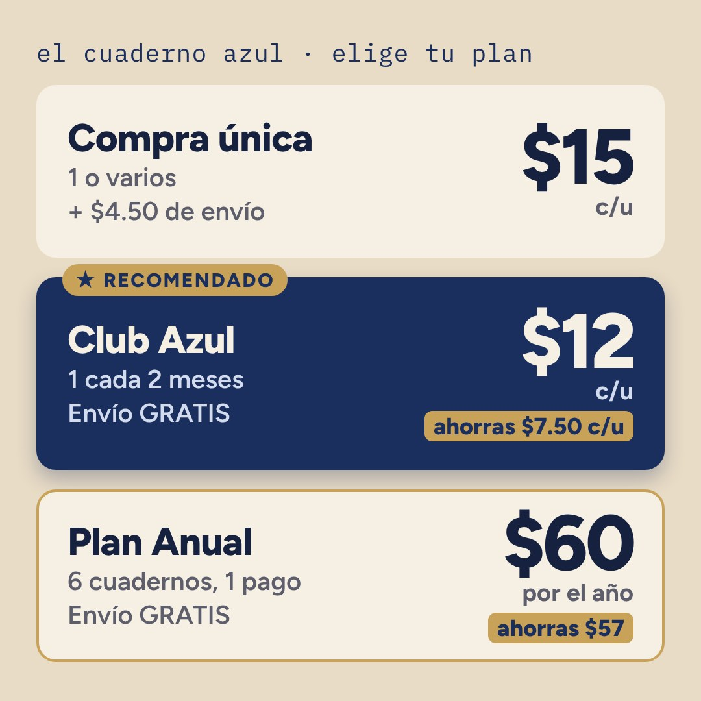

# Upselling: un solo momento, justo después del "¡Lo quiero!"

El porqué de cada decisión está en [09-estrategia.md](09-estrategia.md).

## La tarjeta de planes

<p align="center"></p>

El bot manda esta imagen encima de los 3 botones, con un texto corto debajo. Se genera con **tus precios**:

```
npm run build:image      # vuelve a dibujar assets/planes.jpg con los precios de .env
```

Si cambias un precio en `.env` y no la regeneras, el bot **no** manda la imagen vieja: usa la versión de texto (abajo) hasta que la regeneres. Necesita `PUBLIC_URL` configurado. Si no puedes correr el comando, pídeselo a Claude con los precios nuevos.

## Versión de texto (sin imagen)

```
¡Buenísimo! 🙌 Antes de tus datos, mira esto 👀

🛍️ Compra única: $15 c/u (+ $4.50 de envío, gratis desde 3)

⭐ Club Azul: uno nuevo cada 2 meses a $12, envío GRATIS.
Ahorras $7.50 en cada envío y cancelas cuando quieras.

💎 Anual: 6 cuadernos por $60 ($10 c/u), un solo pago, envío GRATIS.
Ahorras $57 en el año.

[Comprar · $15 c/u]  [⭐ Club · $12 c/u]  [💎 Anual · $60]
```

- La frecuencia (cada mes o cada 2 meses) **no es una pregunta aparte**. Va por defecto y se cambia con un botón en el resumen (**📅 Mejor cada mes**).
- **¿Varios sin suscripción?** Eligen *Comprar* y en el resumen tocan **➕ Agregar otro** las veces que quieran. El total se actualiza al instante y, al llegar a 3, el envío pasa a GRATIS solo. Para bajar, escriben *quitar*. También pueden escribir el número ("quiero 3") en el paso 2. **Más de 20** pasa a ti como mayorista.

## Configurar

```
PRICE_TIERS=1:15          # precio normal por cuaderno
CLUB_PRICE=12.00          # Club: $ por cuaderno, envío incluido
ANNUAL_PRICE=10.00        # Anual: $ por cuaderno pagando el año (0 = no mostrar el Anual)
SUB_DEFAULT_MONTHS=2      # frecuencia por defecto (1 o 2)
FREE_SHIPPING_FROM=3      # compra normal: envío gratis desde N cuadernos
```

Los ahorros que ve el cliente se calculan solos contra comprar 1 cuaderno + envío cada vez.

⚠️ **Precios de ejemplo.** En el Club y el Anual el envío LAAR lo pagas tú. Revisa: `precio − costo del cuaderno − envío` tiene que dejarte margen.
